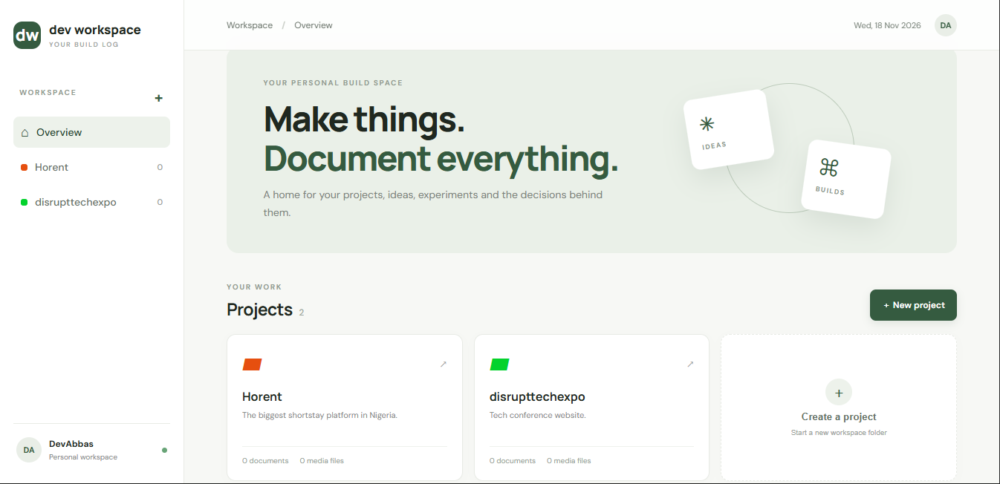
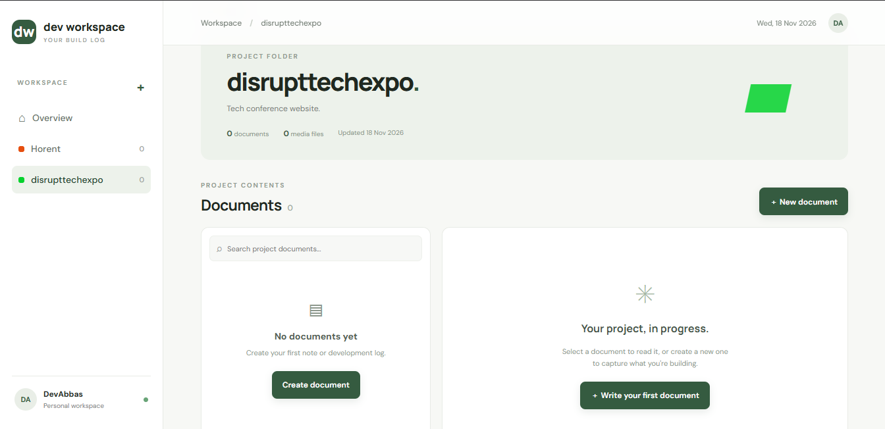
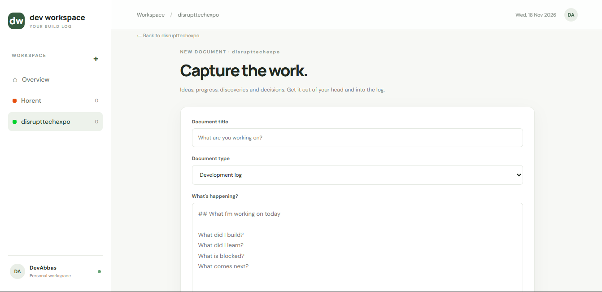
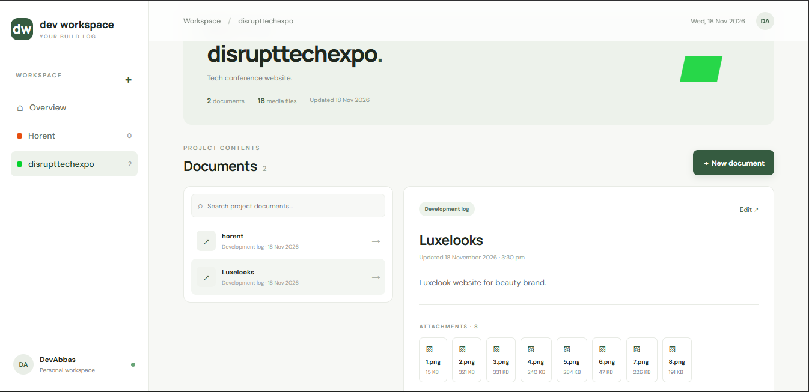

# Dev Workspace

An earlier PHP + MySQL project documentation workspace prototype. Daymark is the planned name for the Next.js version.

## Screenshots

| Overview | Project folder |
| --- | --- |
|  |  |

| New document | Document preview |
| --- | --- |
|  |  |

## Requirements
- PHP 8.0+
- MySQL 5.7+ / MariaDB
- PDO MySQL extension
- Fileinfo extension
- Web server with uploads enabled

## Setup
1. Put the project folder in your local web root (e.g. `htdocs`).
2. Import `database.sql` using phpMyAdmin.
3. Open `config.php` and set your database host, name, username and password.
4. Ensure `uploads/` is writable by PHP.
5. Visit the project folder in your local web server (for example, `http://localhost/dev-workspace/`).

If your MySQL runs on port 3307, change the PDO DSN in `config.php` to:
`mysql:host=127.0.0.1;port=3307;dbname=dev_workspace;charset=utf8mb4`

## Features
- Create project folders
- Create, edit and delete project documents
- Search project documents
- Upload images and PDFs (max 8MB each, 10 at a time)
- Project and document navigation

## Before putting it online
This is a local/private MVP. Add authentication and authorization before exposing it publicly. Keep `config.php` outside public web access where possible, enforce HTTPS, back up the database and uploads, and review upload limits in `php.ini`.
